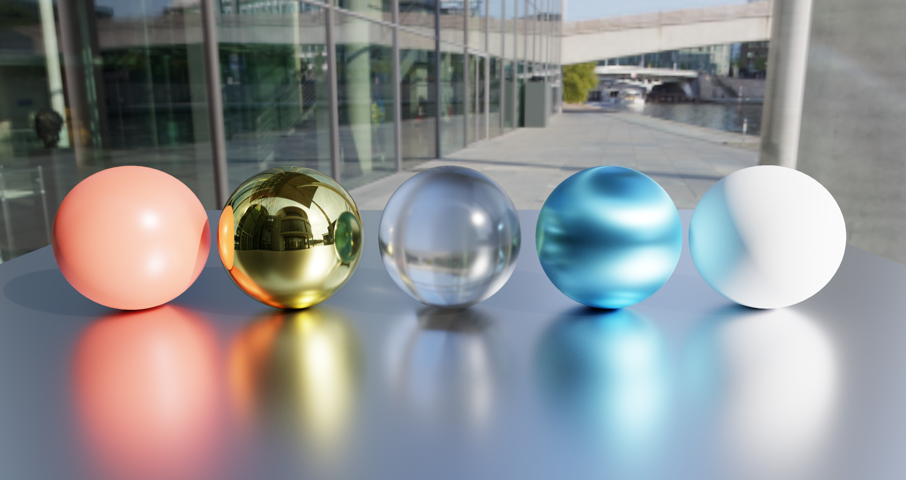
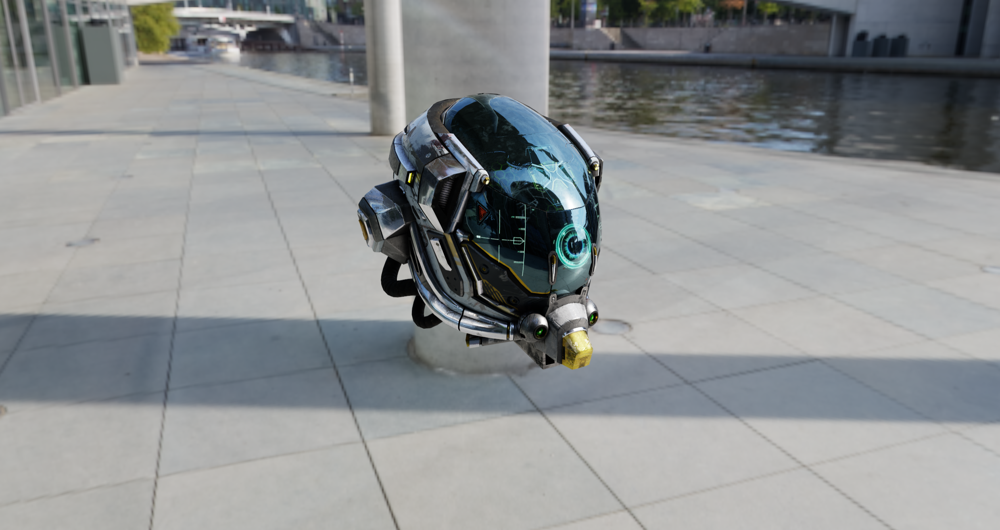
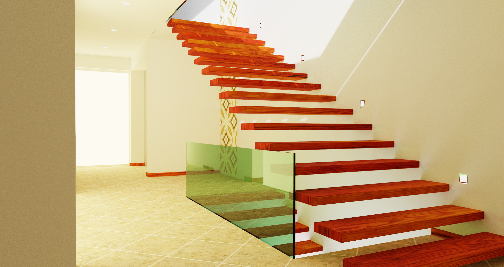
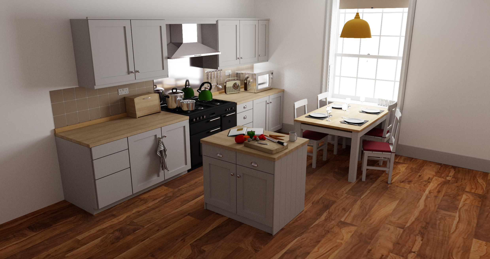
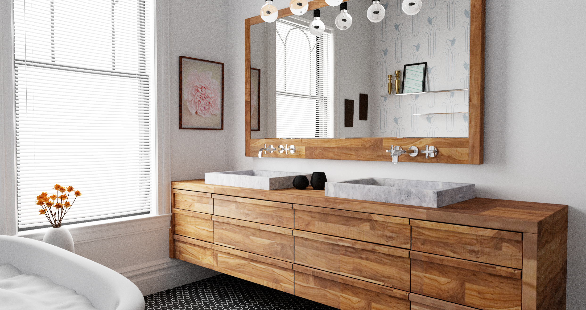
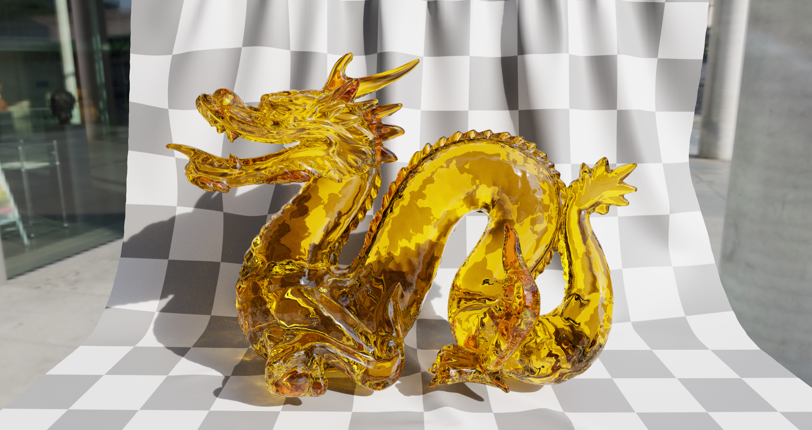

# vulchovy

**vulchovy** 是一个面向研究的实时光线追踪渲染器，基于 **Vulkan 1.3** 与**硬件 ray query**，着色器使用 **Slang** 编写。核心是一个带 **NEE（next-event estimation）** 与 **MIS（multiple importance sampling）** 的单向路径追踪器，支持 PBR metallic-roughness 材质、介电透射、各向异性、HDR 环境光照，以及 glTF / OBJ 模型与场景加载。

## Gallery

| 默认场景（球体阵列 + HDRI） | glTF Damaged Helmet |
| --- | --- |
|  |  |

| Modern Hall | Kitchen |
| --- | --- |
|  |  |

| Bathroom | Dragon（玻璃 / 体积吸收） |
| --- | --- |
|  |  |

| Cornell Box |
| --- |
|  |

## 特性

### 积分器（Integrators）

- **PathTracer**：单向路径追踪，逐帧累积（running average）。相机移动或窗口尺寸变化时自动重置累积。
- **Whitted**：基于硬件 ray query 的 Whitted 风格光线追踪（环境光 + 硬阴影 + 递归镜面反射）。
- **DebugNormals**：调试用的 world-space 法线可视化。
- 另提供一个软件遍历版本的 Whitted（`compute/whitted`），在无 ray query 支持的设备上也能运行。

### 材质（PBR metallic-roughness）

- Lambertian 漫反射 + GGX 镜面，采用 **visible normal distribution sampling**（Heitz 2018）、**Schlick Fresnel** 与 **height-correlated Smith** 遮蔽-阴影。
- **介电透射**：光滑 delta 情形与**粗糙微表面介电**（Walter et al. 2007），支持 IOR 与体积吸收颜色。
- **各向异性 GGX**（高光沿切线方向拉伸）。
- 纹理：base color、metallic-roughness（glTF 约定：G = roughness，B = metallic）、normal map、emissive map。

### 光照（Lighting）

- **HDR 环境光照（IBL）**：equirectangular HDR，使用 **marginal / conditional CDF importance sampling**，并参与 NEE + MIS。
- **解析光源**：point light 与 sphere area light。
- **自发光网格面光源**：triangle CDF 采样 + NEE + MIS。

### 场景与资源

- **glTF / GLB** 加载（cgltf）：节点层级、材质、纹理，以及 `KHR_materials_transmission` / `_volume` / `_ior` 与 emissive strength。
- **OBJ / MTL** 加载（tinyobjloader）。
- 轻量级 **scene graph**（节点、父子关系、局部变换）。
- **JSON 场景文件**只保存模型引用、灯光、环境与相机，文件体积小；几何体在加载时重建。

### 其他

- 逐像素累积，配合 **firefly clamping** 与 **NaN 保护**。
- **ACES** tone mapping。
- **FPS 相机控制器**。
- 默认启用 Vulkan validation layers。

## 依赖与构建

需要：

- CMake ≥ 3.24，以及支持 C++20 的编译器（GCC / Clang）
- Vulkan SDK（提供 `slangc` 与 `glslc`；本项目在 Vulkan SDK 1.4.x 上开发）
- 支持 Vulkan 1.3 与 `VK_KHR_ray_query` 的 GPU

第三方依赖：

- [vulcao](https://github.com/Yang-Junjie/vulcao)：Vulkan 封装库（git submodule，位于 `third_party/vulcao`）
- GLFW、GLM：configure 阶段通过 `FetchContent` 拉取
- stb、tinyobjloader、nlohmann/json、cgltf：内置于 `third_party/`

构建：

```bash
git clone --recursive https://github.com/Yang-Junjie/vulchovy.git
cd vulchovy
cmake -S . -B build -G Ninja
cmake --build build
```

若克隆时未拉取 submodule：

```bash
git submodule update --init --recursive
```

## 运行

```bash
# 内置默认场景（球体阵列 + HDRI 环境）
./build/vulchovy

# 加载 glTF / GLB 模型（相机自动取景）
./build/vulchovy path/to/model.glb

# 加载 OBJ 模型
./build/vulchovy model.obj

# 加载 JSON 场景文件
./build/vulchovy scene.json
```

加载模型文件时，相机会根据模型包围盒自动取景；加载 JSON 场景文件时，使用文件中保存的相机。

### 相机操作（FPS）

| 操作 | 输入 |
| --- | --- |
| 环视 | 按住**鼠标右键**并拖动 |
| 移动 | `W` / `A` / `S` / `D` |
| 上升 / 下降 | `E` / `Q`（或 `Space` / 左 `Ctrl`） |
| 加速 | 按住 `Shift` |
| 调整移动速度 | 滚轮 |

按 `F5` 将当前相机与场景描述保存为 JSON 文件。

## 场景文件格式

```json
{
  "environment": { "path": "assets/modern_buildings_2_2k.hdr", "intensity": 1.0, "rotation": 0.0 },
  "camera": {
    "position": [0.0, 3.0, 9.0],
    "target":   [0.0, 1.0, 0.0],
    "up":       [0.0, 1.0, 0.0],
    "fov": 40.0
  },
  "models": [
    { "path": "assets/models/DamagedHelmet.glb", "name": "helmet", "transform": [ /* 16 个浮点数，column-major */ ] }
  ],
  "lights": [
    { "position": [0.0, 3.6, 0.0], "emission": [6.0, 6.0, 6.0], "radius": 0.7 }
  ]
}
```

- `models[].path` 指向 `.obj` / `.gltf` / `.glb` 文件；`transform` 为 column-major 的 4x4 矩阵。
- `lights[].radius` 为 `0` 表示 point light；大于 `0` 表示 sphere area light。
- 当 `environment.path` 为空或加载失败时，背景为黑色。

## 项目结构

```
src/
  app/          应用与主循环
  camera/       透视相机与 FPS 控制器
  core/         数学类型
  io/           image、OBJ、glTF、scene JSON 读写
  platform/     GLFW 窗口与输入
  render/       display pass 与 integrators（ray_query / compute）
  scene/        CPU/GPU 场景、mesh、environment、descriptors
shaders/
  common/       BSDF、environment、RNG、scene bindings
  integrators/  integrator kernels（Slang）
  display.slang tone mapping 与显示
```

## 致谢

截图所用场景资产来自以下来源。转换后的 glTF 资产为衍生作品，保留其原始许可证。

| 场景 | 来源 | 许可证 |
| --- | --- | --- |
| Bathroom | [gltf-research-scenes](https://github.com/ErfanMo77/gltf-research-scenes) | CC0-1.0 |
| Cornell Box | [gltf-research-scenes](https://github.com/ErfanMo77/gltf-research-scenes) | CC0-1.0 |
| Dragon | [gltf-research-scenes](https://github.com/ErfanMo77/gltf-research-scenes) | CC-BY-3.0 |
| Kitchen | [gltf-research-scenes](https://github.com/ErfanMo77/gltf-research-scenes) | CC-BY-3.0 |
| Modern Hall | [gltf-research-scenes](https://github.com/ErfanMo77/gltf-research-scenes) | CC-BY-3.0 |
| Damaged Helmet | [Khronos glTF Sample Assets](https://github.com/KhronosGroup/glTF-Sample-Assets) | 见来源 |
| HDRI 环境贴图 | [Poly Haven](https://polyhaven.com/) | CC0 |

其中许多场景源自 [Benedikt Bitterli Rendering Resources](https://benedikt-bitterli.me/resources/)。感谢原作者以及转换仓库的维护者。

使用的库：

- [vulcao](https://github.com/Yang-Junjie/vulcao)：Vulkan 封装库
- [Slang](https://shader-slang.com/)：着色器语言
- [cgltf](https://github.com/jkuhlmann/cgltf)、[tinyobjloader](https://github.com/tinyobjloader/tinyobjloader)、[stb](https://github.com/nothings/stb)、[nlohmann/json](https://github.com/nlohmann/json)：资源加载
- [GLFW](https://www.glfw.org/)、[GLM](https://github.com/g-truc/glm)

## 许可证

本项目基于 [MIT License](LICENSE) 发布。第三方资产保留其各自原始许可证，见上方列表。
